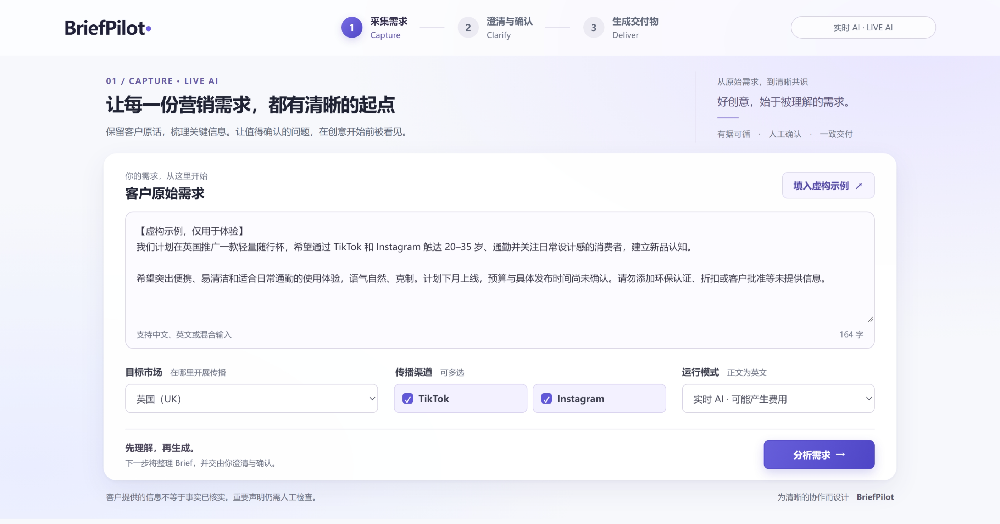
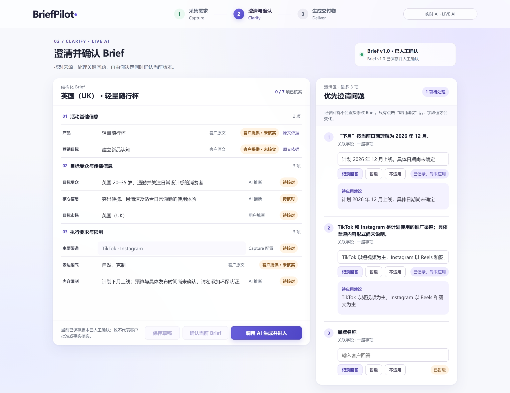
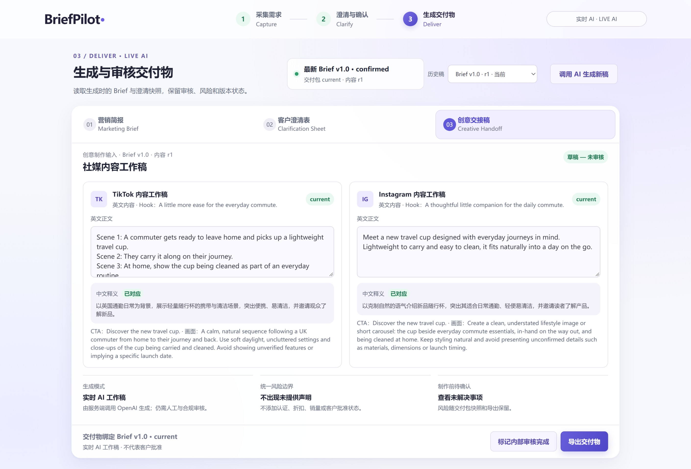

# BriefPilot｜可信 AI Brief 工作流

> From ambiguous requests to accountable creative handoffs.

BriefPilot 是面向中国出海营销代理团队 Account / Planner 的 Lean MVP。它把中文、英文或混合语言的模糊客户需求，转化为可追溯、可澄清、可人工确认并能安全交接的营销 Brief 工作流。

产品重点不是“一键生成文案”，而是让团队能够回答：信息来自哪里、哪些内容仍待核实、谁确认了当前 Brief、交付物基于哪个版本，以及需求变化后哪些旧稿需要复审。

## 产品展示

**在线 Demo：部署准备中，当前暂无公开链接。** 后续公开 Demo 将固定使用 `local_fixture`，不配置 API Key，也不会调用 OpenAI。

下列截图来自一次受控的 **GPT-6 Luna 真实 AI 测试**，用于展示真实模型接入后的三阶段产品界面；它们不代表公开 Demo 会发起模型请求，也不代表客户、市场或法律审核结论。

### Capture｜保留原始需求并结构化关键信息



### Clarify｜核对来源、处理问题并人工确认



### Deliver｜绑定 Brief 快照、审核并安全导出



产品能力集中在来源与核实状态、最多三个优先澄清问题、人工应用建议、Brief 版本、Change Impact Review、交付物快照及风险感知式导出。公开 Demo 使用同一套前端、HTTP API 与业务规则，但仅返回明确标注的固定虚构数据。

## 核心流程

1. **Capture｜采集需求**：输入原始需求，选择英国或美国市场以及 TikTok / Instagram 渠道。
2. **Clarify｜澄清与确认**：检查结构化 Brief、字段来源和核实状态；回答最多三个优先问题，并显式应用建议；分别执行保存草稿和人工确认。
3. **Deliver｜生成与审核**：基于已保存且已确认的 Brief 生成营销简报、客户澄清表和创意交接稿；编辑、内部审核并导出 Markdown / JSON。

## 已实现能力

- Pydantic 结构化 Brief 与 OpenAI structured output 适配。
- 核心字段来源：客户原文、用户填写、AI 推断或未知；原文片段只在输入中存在精确依据时保存。
- 独立核实状态；“客户提供”不等于事实已验证。
- 最多三个结构化澄清问题，支持回答、暂缓、不适用和显式应用。
- 保存草稿与人工确认分离；仅实质变化增加 Brief 版本。
- 受众、营销目标、核心信息或目标市场变化时撤销确认，并触发 Change Impact Review。
- DraftPackage 绑定 Brief 版本、Brief 深拷贝快照和澄清快照。
- 新稿追加到当前会话历史；生成失败不清除旧稿。
- `current` / `stale` 生命周期；旧稿保留并记录过期原因。
- TikTok / Instagram 英文稿与中文释义；英文人工编辑后释义标记为待更新。
- 内容修订号与内部审核状态绑定；内部审核不代表客户、市场或法律批准。
- 后端按指定交付包生成风险感知式 Markdown / JSON 导出。

## 当前主架构

```text
HTML / CSS / JavaScript
        ↓ fetch
Python 标准库 HTTP API
        ↓
WorkspaceSession + Pydantic + 纯业务函数
        ↓
local_fixture 或显式 live_ai 适配器
        ↓
人工澄清、确认、审核与导出
```

- 当前主工作流：`design_prototype/` + `integration_api.py`。
- 业务模型与纯函数：`models.py`、`logic.py`。
- `app.py` 是保留的早期 Streamlit 实现，不是当前高保真三页面主入口。
- 不使用数据库、登录系统或客户端 OpenAI 调用。

## Windows 本地运行

需要 Python 3.11 或更高版本。

```powershell
python -m venv .venv
.\.venv\Scripts\Activate.ps1
python -m pip install -r requirements.txt
python integration_api.py
```

打开：`http://127.0.0.1:8767/`

健康检查：`GET http://127.0.0.1:8767/api/health`

可选参数：

```powershell
python integration_api.py --host 127.0.0.1 --port 8767
```

### Render Public Demo

Render Web Service 使用以下配置：

```text
Build Command: pip install -r requirements.txt
Start Command: python integration_api.py --host 0.0.0.0
Health Check Path: /api/health
```

服务会读取 Render 提供的 `PORT`；本地未设置 `PORT` 时仍使用 `8767`。检测到 Render 的 `RENDER=true` 后，后端会强制进入公开演示安全模式：健康检查只声明 `local_fixture`，任何直接提交的 `live_ai` Capture 或 Deliver 请求都会被拒绝，且不会读取 API Key。建议同时显式设置 `BRIEFPILOT_PUBLIC_DEMO=true`，便于在 Render 控制台中清楚标识部署用途。公开 Demo 不应设置 `OPENAI_API_KEY` 或 `BRIEFPILOT_OPENAI_MODEL`。

如需查看保留的 Streamlit 版本：

```powershell
streamlit run app.py
```

## 运行模式

### `local_fixture`（默认）

- 使用明确标注的虚构英国/美国随行杯测试数据。
- 不需要 API Key，不调用 OpenAI，也不会产生模型费用。
- 前端、HTTP API、会话、版本、确认、审核、stale 和导出均走真实本地代码。
- 固定测试内容不应被描述为模型输出或客户批准内容。

### `live_ai`（显式选择）

- 只有用户在 Capture 选择实时模式并再次确认操作后，服务端才调用 OpenAI。
- 使用者需要在服务端进程环境中自行配置有效的 `OPENAI_API_KEY`。
- Capture 复用 `parse_brief`；Deliver 复用 `generate_drafts`。
- 缺少密钥、认证失败、额度不足、超时或模型校验失败时返回明确错误，不会静默降级成 fixture。
- 失败不会删除现有输入、Brief 或旧交付包。
- 模型输出必须经过人工核对；内部审核不代表客户批准、事实核实或法律合规确认。

### OpenAI 模型选择

未设置模型环境变量时，`live_ai` 默认使用 `gpt-4o-mini`。如需显式使用 GPT-6 Luna，请在启动服务前设置 `BRIEFPILOT_OPENAI_MODEL`：

```powershell
$env:BRIEFPILOT_OPENAI_MODEL = "gpt-6-luna"
$env:OPENAI_API_KEY = "<your-local-api-key>"
python integration_api.py --host 127.0.0.1 --port 8767
```

当前支持 `gpt-4o-mini` 和 `gpt-6-luna`。环境变量只在 Python 服务启动时读取；修改后需要重启服务。不支持的模型值会返回明确配置错误，不会自动改用其他模型。若不设置 `BRIEFPILOT_OPENAI_MODEL`，服务保持 `gpt-4o-mini` 默认值。`local_fixture` 不需要设置模型或 API Key。

服务端只从进程环境读取密钥。示例仅使用占位符：

```powershell
$env:OPENAI_API_KEY = "<your-local-api-key>"
python integration_api.py
```

不要把密钥写入前端、请求正文、截图、日志或 Git。`.env`、`.streamlit/secrets.toml`、`.venv/` 和 `test_exports/` 已加入忽略规则。

## 测试

```powershell
python -m pytest -q
```

当前已验证结果：

```text
78 passed
```

测试覆盖纯业务规则、fixture HTTP 流程、浏览器会话隔离、Brief 保存与确认、澄清应用、DraftPackage 快照、旧稿保留、stale、审核、导出和 live AI 安全错误映射。`live_ai` 自动化边界使用依赖注入 Mock，自动化测试不会产生收费 API 请求。

## 会话与持久化边界

- HTTP 主工作流以 HttpOnly Cookie 区分浏览器会话。
- 同一浏览器的刷新、返回和正常阶段导航会保留当前进程内的数据。
- 不同浏览器 Cookie 相互隔离。
- 会话只保存在 Python 进程内存；服务重启后全部工作区和交付包失效，页面会提示重新 Capture。
- 没有数据库、跨设备同步、多用户权限或长期历史中心。
- Streamlit 版本使用自己的 Session State，与 HTTP 工作流会话不共享。

## 尚未验证与后续方向

- 已使用 `gpt-6-luna` 完成一次受控真实 AI Capture → Clarify → Deliver → Markdown / JSON 导出的端到端验证。
- 此后完成了 Clarify / Deliver 的小范围 UI 修复；最新 UI 回归使用 `local_fixture`，尚未再次执行付费真实 AI 全流程。
- 尚未完成真实营销质量、英国/美国文化适配、客户接受度或法律合规验证。
- 尚未部署公开生产环境，也没有认证、限流、持久化和多租户安全能力。
- 尚未完成移动端、跨浏览器、读屏器和完整键盘无障碍审计。
- 下一步应先在最新 UI 上重新执行受控真实 API 回归和演示设备 QA，再考虑持久化、权限或更细粒度的影响分析。

## 非目标

当前 MVP 不包含账户系统、团队管理、统计看板、自动发布、联网事实核查、RAG、复杂 Agent、图片生成、完整历史版本中心或客户审批系统。
